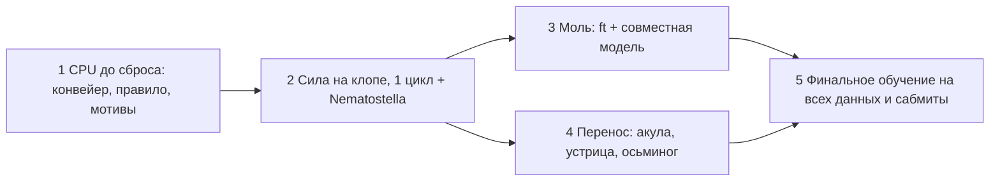
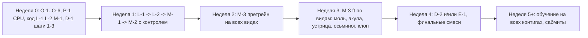

# План до конца соревнования

Составлен 2026-10-16. Состояние: [STATUS.md](STATUS.md). Обновлять статусы шагов после каждого завершённого шага (и дублировать в журнал STATUS.md).

## Исходные факты

* Место вида на сайте = порядок по **произведению мест AUPRC × Spearman** среди всех сабмитов. Наши места (AUPRC×Spearman): клоп 33×6, моль 187×34, устрица 34×11, акула 48×24, осьминог 24×13. Главный рычаг: **AUPRC**, прежде всего моль, затем акула.
* `big2` (больше модель, 96k шагов) прироста не дал (0.159 / 0.444 = wide 96k): упор не в размер.
* Явные мотивы (бинарные признаки из баз) в LightGBM проверены: +0.002 AUPRC в смеси; трек интерпретируемости (§Трек I) это не закрывает. RC-симметрия встроена. Дешёвая постобработка ≤3% AUPRC с потерей Spearman. Голова силы поверх готового скора не помогла (дообучение внутри v2 ещё не проверено).
* Потолок по репликам клопа: 0.32 / 0.92. Запас по Spearman больше, чем по AUPRC, но места считаются по произведению, поэтому нужны оба.
* GPU-квота `ivanmitochondrion` и `k13polinaa` исчерпана до недельного сброса. CPU-ядра бесплатны. Evo2/AlphaGenome недоступны на T4/P100.
* Правила (EPIC_final.pdf, п. 2.6, дословно): «Only the genome sequences and the EPIC-provided transcription initiation tracks may be used. Existing annotations, orthology relationships, expression data, other experimental tracks, or any other external data are not permitted. The exception is pretrained genomic models, such as (but not limited to) AlphaGenome or Evo 2 published prior to the challenge start date.» Значит: геном + треки инициации от организаторов (csRNA-seq). **Уточнение организаторов от 2026-09-29: базы мотивов (JASPAR, HOCOMOCO, TRANSFAC, CIS-BP) разрешены**, хотя текст п. 2.6 формально строже; в описании сабмита называем базу и версию. Внешние аннотации и другие экспериментальные треки по-прежнему запрещены. sRNA-seq («other experimental track») как обучающая цель: вопрос (б) к организаторам, ждёт Ивана. Дедлайн: 2026-12-31.

## Правило CPU-first (Иван, 2026-10-16)

Всё, что можно, считаем на CPU-ядрах Kaggle (сессия до 12 ч, недельной квоты нет), даже медленно. GPU только там, где CPU не успеет.

| на CPU (сейчас, до сброса) | честно требует GPU |
|---|---|
| инференс готовых чекпоинтов на hold-out и test (ансамбли, TTA по сдвигам) | полное обучение v2 с нуля (на CPU в 10–30 раз медленнее, не влезает в 12 ч) |
| смеси v2+v3, сетка alpha/веса, правило по произведению мест, калибровка tune→сайт | дообучение всей сети на виде (ft 24–48k шагов) |
| атрибуции, MoDISco, анализ ошибок, разбор мотивов | совместная модель клоп+моль |
| короткое дообучение **только головы силы** на замороженных признаках (сначала кэш признаков инференсом, потом обучение головы на CPU) | финальное обучение на всех данных |
| LightGBM/простая модель, постобработка, проверка на Nematostella (инференс) | |

Следствия для шагов:
* **Шаг 1** целиком на CPU и расширен: инференс всех готовых чекпоинтов (`bug`, `bug+moth`, `big2`, ft-модели) с сохранением hold-out скоров и кэша признаков; смеси и правило на готовых скорах.
* **Шаг 2**: сначала CPU-вариант силы (голова на замороженной сети, кэш признаков, ≤12 ч). GPU-дообучение `epic-v2-ofas-strength` только если голова на CPU покажет сигнал (Spearman +0.01 и выше).
* **Шаги 3–5**: смеси, alpha, отбор файлов, проверка файлов на CPU; на GPU остаются только ft и финальное обучение.

## Порядок шагов

Изменение к предложенному порядку: шаги 3 и 4 идут параллельно на двух аккаунтах после шага 2 (квота делится), а моль имеет приоритет за акулой при нехватке GPU-часов: ранги моли самые худшие (187×34), один ранг AUPRC там стоит больше всего.

### Шаг 1. CPU до сброса квоты: конвейер, правило, мотивы моли

| | |
|---|---|
| цель | Собрать единый конвейер без GPU-запусков: (a) скрипт-конвейер `v2 (±сила) → ft на виде → смесь с v3 → единое правило alpha/веса → финальное обучение на всех данных` с переменными `EPIC_*`; (b) правило выбора alpha/смеси = минимум произведения мест (`tools/lb_rank.py`, `SELECT=lb`, калибровка tune→сайт 0.877/0.894); (c) мотивы моли/клопа: атрибуции + MoDISco на CPU, вывод, есть ли сигнал вне уже проверенного |
| что запускать | только CPU-ядра Kaggle (бесплатно) и локальный код без обучения; GPU 0 ч |
| критерий успеха | конвейер проходит сухой прогон на CPU (малый срез, без падений по устройствам/RNG); правило на клопе воспроизводит калибровку (α0.65 вместо α0.70); отчёт по мотивам: список мотивов с долей AUPRC-вклада на hold-out. Если вклад ≤ +0.002 — мотивы закрываем |
| владелец | «Регрессия силы старта в v2» (конвейер, правило); «Мотивы старта полимеразы» (мотивы) |
| статус | в работе |

### Шаг 2. Голова силы на клопе, один полный цикл с проверкой на Nematostella

| | |
|---|---|
| цель | Проверить, даёт ли канал силы s внутри v2 (hurdle, `STRENGTH_HEAD`) прирост Spearman без потери AUPRC; прогнать **весь** конвейер один раз на клопе |
| что запускать | после сброса: `epic-v2-ofas-strength` (дообучение seed0, 16k шагов, веса силы 0.1 и 0.5) ≈ 2–3 GPU-ч; затем ft/смесь/правило на CPU. Проверка на Nematostella (открытые метки, без загрузки на сайт): 1 GPU-запуск ≈ 3–4 GPU-ч, если сигнал есть |
| критерий успеха | report клопа: AUPRC ≥ 0.217 (смесь сейчас) и Spearman ≥ 0.515, или произведение мест на сайте лучше 33×6 по калибровке. Nematostella: то же направление изменений. Иначе голову силы отключаем и идём дальше |
| владелец | «Регрессия силы старта в v2» |
| статус | ждёт сброса GPU-квоты (ошибка `torch.cat` исправлена, `ed2c567`) |

### Шаг 3. Моль: дообучение и совместная модель (+0.03 AUPRC)

| | |
|---|---|
| цель | Поднять AUPRC моли (сейчас 0.240, лучший 0.283), где ранги хуже всего |
| что запускать | GPU ≈ 10–12 ч на аккаунт: (a) ft моли с лучшими настройками шага 2 (48k шагов, LR 6e-4); (b) совместная модель клоп+моль (общая сеть) с честным hold-out; (c) смесь с v3 с честной оценкой (v3b2 видела контиги report моли: для оценки нужен v3 с отложенными контигами или фиксированный вес 0.4) |
| критерий успеха | честный report моли ≥ +0.03 AUPRC к текущему сабмиту без потери Spearman > 0.01; оценка мест по `lb_rank.py` улучшает произведение 187×34 |
| владелец | новый тред (создаётся по запросу после шага 2) |
| статус | ждёт шага 2 |

### Шаг 4. Перенос на акулу, устрицу, осьминога

| | |
|---|---|
| цель | Применить конвейер из шагов 2–3 к остальным видам; акула и устрица приоритетнее осьминога (24×13) |
| что запускать | GPU ≈ 6–8 ч на вид (ft 48k шагов) по шаблону `epic-v2-ft2-*`; смеси и alpha по правилу, на CPU |
| критерий успеха | акула: AUPRC ≥ 0.12 при Spearman ≥ 0.49 (сейчас 0.103 / 0.491 в зачёте, смесь 0.121 / 0.462); устрица ≥ 0.13 / 0.34; осьминог ≥ 0.08 / 0.39; произведение мест не хуже текущего |
| владелец | новые треды по видам |
| статус | ждёт шага 2 |

### Шаг 5. Финальные сабмиты

| | |
|---|---|
| цель | Финальное обучение на всех данных и отправка лучших файлов по каждому виду |
| что запускать | GPU: обучение на всех контигах с зафиксированными alpha/весом (по правилу, без подбора), несколько сидов; запас квоты не менее 1 вида целиком |
| критерий успеха | для каждого вида файл с описанием в `SUBMISSIONS.md`; ни одного сабмита хуже текущего зачётного по оценке; общее место ≤ 5 |
| владелец | тред конвейера + пользователь (ручная загрузка на сайт) |
| статус | ждёт шагов 2–4 |

## Бюджет GPU

* Квота: ~30 ч/неделю на аккаунт, 2 аккаунта, не более 2 GPU-сессий на аккаунт, сессия ≤ 11.5 ч. Скорость v2: ~7.3k шагов/ч на T4.
* Первая неделя после сброса: шаг 2 (≈6 ч), шаг 3 (≈20 ч), шаг 4 акула+устрица (≈14 ч). Остальное: шаг 4 осьминог и шаг 5 на следующей неделе.
* Если дата конца соревнования раньше второго сброса, шаг 5 урезается до моли и клопа.

## Правила для всех шагов

* Результат каждого прогона фиксируется в STATUS.md и `SUBMISSIONS.md`; файл сабмита описывается по CLAUDE.md (вид, путь, теги, описание на английском).
* Подбор alpha и веса смеси только правилом по произведению мест; не подбирать по сайту.
* Токены Kaggle только в заголовке запроса, не в файлах и логах.

## Задание «список доработок» (2026-10-16): что добавлено и в каком порядке

Дополняет и переупорядочивает шаги выше; детали задач (L-1, L-2, M-1, M-2, M-3, D-1, D-2, E-1, P-1, C-1, I-1…I-5) — в сообщении Ивана в корне треда «EPIC: список доработок» (project chat). Протокол A/B: база `Ofas_2.0_v2_seed0` (`ivanmitochondrion/epic-v2-ofas-ckpt`), ft 16k шагов LR 6e-4, **контроль — такой же ft без изменения, тот же сид**; порог: AUPRC +0.005 при потере Spearman ≤ 0.005 либо лучше произведение мест.

Соответствие старым шагам: шаг 2 («голова силы») остаётся за тредом «Регрессия силы старта в v2» и идёт на GPU-квоте параллельно L-1 (GPU сбрасывается ≈ 2026-10-17 00:25 UTC на `ivanmitochondrion`); шаг 3 (моль) и шаг 4 (перенос) становятся M-3 (претрейн на всех видах, затем ft); шаг 5 без изменений. Зависимости: M-3 после L-1/L-2/M-1; E-1 только если M-1 не дал прироста; C-1 после M-3.

### Трек I: интерпретируемая модель (параллельно, критерии не лидербордные)

`simple_model` — не борьба за очки, а отдельный трек интерпретируемости. Следующие шаги: I-1 (перезапуск мотивной модели по схеме Puffin, PWM из TF-MoDISco и CIS-BP), I-2 (дистилляция v2 в интерпретируемую модель, ключевая), I-3 (межвидовое сравнение компонент), I-4 (ISM-проверка у v2), I-5 (REPORT.md + ноутбук; объём зависит от вопроса (в)). Критерии: I-1 AUPRC ≥ 0.02 на тесте Nematostella при ≤ 32 компонентах; I-2 Spearman с v2 ≥ 0.6 при ≤ 32 компонентах и AUPRC ≥ 0.02.
